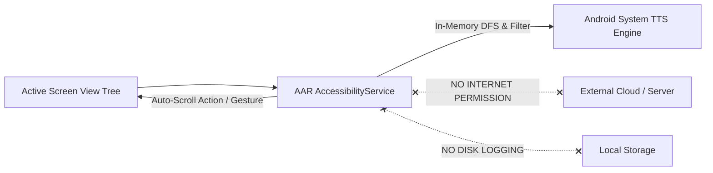
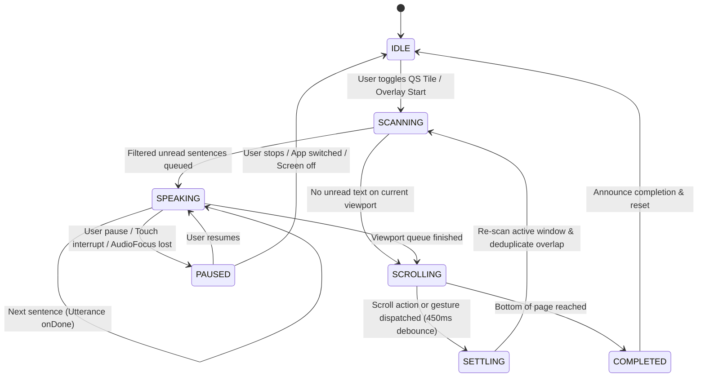

<div align="center">

# 🔊 AAR — Accessibility Auto-Reader for Android

**A modern, lightweight, privacy-first Android Accessibility auto-reader that extracts on-screen text, speaks it aloud via native TTS, and automatically scrolls continuously until the end of the page.**

[-3DDC84?style=flat-square&logo=android&logoColor=white)](https://android.com)
[](https://store.google.com)
[](https://kotlinlang.org)
[](https://developer.android.com/jetpack/compose)
[](#-privacy--security-by-design)
[](LICENSE)

[English](README.md) • [繁體中文](README_zh.md) • [Specification (開發規格書)](SPEC.md)

</div>

---

## 📖 Overview

**AAR (Accessibility Auto-Reader)** is an open-source Android utility built with **Kotlin** and **Jetpack Compose (Material 3)**. Powered by Android's native `AccessibilityService` and `TextToSpeech` (TTS) engine, AAR parses visible text on the active screen in real time, reads it aloud sentence by sentence, and automatically performs downward scroll gestures to provide a hands-free, continuous reading experience across articles, e-books, web pages, and social feeds.

Unlike cloud-based screen readers or third-party voice assistants, AAR processes all screen hierarchy analysis and speech synthesis **100% locally on your device**. The application requests **zero internet permissions (`android.permission.INTERNET`)**, guaranteeing that your on-screen content and personal data never leave your phone.

---

## ✨ Key Features

| Feature | Description |
| :--- | :--- |
| 🧠 **Smart DFS Screen Parser** | Traverses `AccessibilityNodeInfo` view hierarchies via Depth-First Search (DFS), sorting visible text top-to-bottom and left-to-right by screen coordinates. |
| 🧹 **Noise & Control Filtering** | Automatically excludes hidden nodes, decorative icons, password fields, and non-content UI controls (e.g., "Copy", "Share", "Back", "More"). |
| 🔄 **Continuous Auto-Scroll** | Dual-engine downward scrolling: prioritizes native `ACTION_SCROLL_FORWARD` node actions and seamlessly falls back to smooth `dispatchGesture` swipe paths. |
| 🛡️ **Overlap Deduplication** | Sliding-window text fingerprint buffer prevents re-reading overlapping paragraphs remaining at the top of the screen after a scroll gesture. |
| 🛑 **Bottom-of-Page Detection** | Automatically detects when a page can no longer scroll or no new text appears, gracefully concluding the reading session. |
| ⚡ **Quick Settings Tile & HUD** | Toggle reading instantly from the system Quick Settings (`TileService`) or control playback via a compact `TYPE_ACCESSIBILITY_OVERLAY` floating pill. |
| 🎯 **Visual Reading Highlight** | Optional Material 3 highlight box overlay that tracks and frames the currently spoken paragraph in real time on screen. |
| 🗣️ **Native TTS & Offline Pack Check** | Supports adjustable speech rate (`0.5x` – `2.0x`), Traditional Chinese (`zh-TW`) & English (`en-US`) switching, and offline voice pack verification. |
| 🎧 **AudioFocus & Safety Guards** | Automatically pauses on incoming calls, headset disconnection (`ACTION_AUDIO_BECOMING_NOISY`), app switching, or screen lock. |
| 🔒 **100% Offline & Zero-Knowledge** | Operates strictly in-memory without `android.permission.INTERNET`. Zero telemetry, zero analytics, and zero external data transmission. |

---

## 🔒 Privacy & Security by Design

Because `AccessibilityService` has access to on-screen content, privacy is the core pillar of AAR:



1. **Zero Internet Access**: `AndroidManifest.xml` does not declare `android.permission.INTERNET`. The app is physically incapable of transmitting screen content over the network.
2. **Ephemeral In-Memory Processing**: Extracted screen text is held strictly in transient memory queues for immediate TTS playback and is never written to disk or databases.
3. **Password & Sensitive Node Exclusion**: Nodes marked with `isPassword == true` are strictly ignored during tree traversal.
4. **No Third-Party SDKs**: Zero analytics, zero ad networks, and zero tracking dependencies.

---

## 🏗️ Architecture & Tech Stack

AAR follows Modern Android Development (MAD) best practices with Clean Architecture and Unidirectional Data Flow (UDF):

```text
AAR Architecture
├── Presentation Layer (Jetpack Compose + Material 3)
│   ├── MainActivity.kt ── SettingsViewModel.kt (StateFlow / UDF)
│   └── OverlayHudController.kt (TYPE_ACCESSIBILITY_OVERLAY Control & Highlight Box)
├── Core Service & Domain Layer
│   ├── AutoReaderAccessibilityService.kt (AccessibilityService + Lifecycle)
│   ├── AutoReaderTileService.kt (Quick Settings TileService)
│   ├── ScreenTreeParser.kt (DFS Traversal, Coordinate Sorting & Noise Filter)
│   ├── AutoScrollEngine.kt (Node Scroll + Gesture Dispatch + Deduplication)
│   └── TtsController.kt (TextToSpeech, UtteranceProgressListener, AudioFocus)
└── Data Layer (Jetpack DataStore)
    └── UserPreferencesRepository.kt (Speech Rate, Locale, Scroll & Filter Settings)
```

### Technology Highlights

- **Platform & Target**: Android 17 (API Level 37+) • Target Hardware: **Google Pixel 8 Pro**.
- **UI & Design**: [Jetpack Compose](https://developer.android.com/jetpack/compose), Material Design 3 (M3) Dynamic Color.
- **Language & Concurrency**: [Kotlin 2.2+](https://kotlinlang.org/), Kotlin Coroutines, `StateFlow`.
- **Core Android APIs**:
  - `android.accessibilityservice.AccessibilityService` & `GestureDescription`
  - `android.view.accessibility.AccessibilityNodeInfo`
  - `android.speech.tts.TextToSpeech` & `UtteranceProgressListener`
  - `android.service.quicksettings.TileService`
- **Persistence**: Jetpack DataStore (`Preferences DataStore`) for reactive user settings.
- **Quality & Testing**: JUnit 4, Robolectric, Kotlinx Coroutines Test, JaCoCo Code Coverage.

---

## 🔄 Automated Reading & Scroll State Machine



---

## 📋 Development Specification

For detailed architectural requirements, node filtering heuristics, TTS language verification, and auto-scroll state control, please refer to the full specification document:
👉 **[SPEC.md — 無障礙朗讀與自動捲動應用程式開發規格書](SPEC.md)**

---

## 🤝 Contributing

Contributions, issue reports, and feature suggestions are welcome!

1. **Fork** the repository.
2. **Create** a feature branch: `git checkout -b feature/awesome-feature`.
3. **Commit** your changes following conventional commits: `git commit -m "feat: add support for xyz"`.
4. **Push** to your branch: `git push origin feature/awesome-feature`.
5. **Open a Pull Request**.

---

## 📄 License

This project is licensed under the **MIT License** — see the [LICENSE](LICENSE) file for details.
