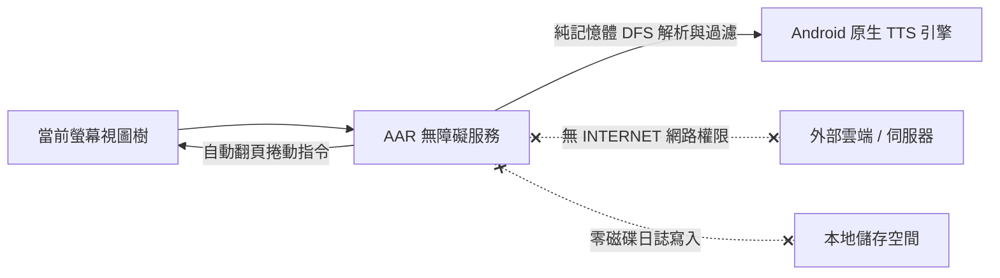
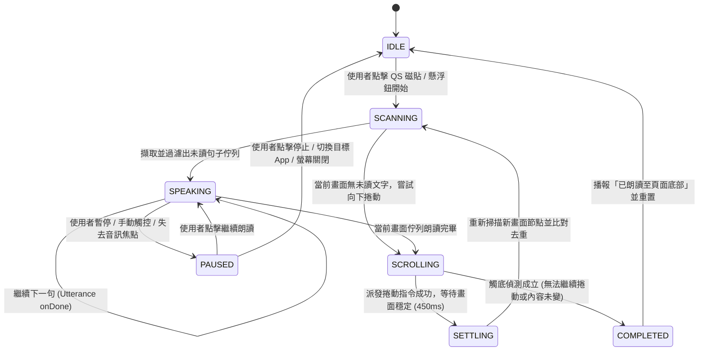
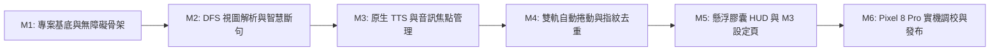

<div align="center">

# 🔊 AAR — Android 無障礙螢幕朗讀與自動捲動工具

**一款現代化、輕量、極度注重隱私的開源 Android 無障礙輔助應用，即時解析螢幕可見文字並透過原生 TTS 語音朗讀，讀畢後自動向下捲動翻頁直至頁面底部。**

[-3DDC84?style=flat-square&logo=android&logoColor=white)](https://android.com)
[](https://store.google.com)
[](https://kotlinlang.org)
[](https://developer.android.com/jetpack/compose)
[](#-隱私與安全架構設計)
[](LICENSE)

[English](README.md) • [繁體中文](README_zh.md) • [完整開發規格書 (SPEC.md)](SPEC.md)

</div>

---

## 📖 專案簡介

**AAR (Accessibility Auto-Reader)** 是一款使用 **Kotlin** 與 **Jetpack Compose (Material 3)** 打造的現代化 Android 無障礙輔助工具。透過 Android 原生無障礙服務（`AccessibilityService`）與系統文字轉語音引擎（`TextToSpeech`），AAR 能即時擷取當前螢幕上的可見文字、智慧過濾無關介面按鈕，並依照自然閱讀順序逐句朗讀；當畫面文字朗讀完畢後，更會自動觸發向下捲動手勢，實現長篇文章、網頁、電子書與社群貼文的免動手連續朗讀體驗。

考量到無障礙服務具備讀取螢幕內容的高敏權限，AAR 在架構設計上採取最高標準的隱私保護：**100% 在手機本地端記憶體內完成解析與語音合成**，在 `AndroidManifest.xml` 中**完全未宣告任何網路權限 (`INTERNET`)**，確保您的螢幕文字與個人隱私絕不離開裝置！

---

## ✨ 核心特色

| 功能 | 說明 |
| :--- | :--- |
| 🧠 **智慧 DFS 視圖樹解析** | 透過深度優先搜尋（DFS）遍歷 `AccessibilityNodeInfo` 節點樹，依螢幕絕對座標（由上至下、由左至右）重組自然閱讀佇列。 |
| 🧹 **噪音與控制鈕智慧過濾** | 自動排除隱藏節點、純裝飾圖示、密碼欄位，以及系統無關控制標籤（如「複製」、「分享」、「返回」、「更多選項」）。 |
| 🔄 **雙軌連續自動捲動** | 優先呼叫原生可捲動容器之 `ACTION_SCROLL_FORWARD`，並支援平滑模擬手勢滑動（`dispatchGesture`）作為 Fallback，相容各類 App。 |
| 🛡️ **捲動重疊文字去重** | 內建滑動視窗文字指紋比對（Sliding Window Fingerprint），自動跳過捲動後殘留於畫面頂部的已讀段落，不重複朗讀。 |
| 🛑 **智慧觸底偵測** | 當頁面無法繼續捲動或捲動後無新增未讀文字時，自動判定到達頁面底部並優雅結束朗讀任務。 |
| ⚡ **下拉快捷磁貼與懸浮膠囊** | 整合系統下拉控制中心 `TileService` 一鍵啟停，並提供免額外權限的 `TYPE_ACCESSIBILITY_OVERLAY` 迷你懸浮控制列。 |
| 🎯 **即時朗讀焦點高亮框** | 支援於螢幕當前朗讀段落繪製 Material 3 視覺焦點外框（Highlight Overlay），清楚掌握目前閱讀位置。 |
| 🗣️ **原生 TTS 與離線語音檢查** | 支援 `0.5x ~ 2.0x` 語速滑桿調節、繁體中文（`zh-TW`）與英文（`en-US`）切換，並主動檢測系統高品質離線語音包狀態。 |
| 🎧 **音訊焦點與中斷安全保護** | 整合 `AudioFocus` 與系統廣播，於來電、拔除耳機、手動切換 App 或螢幕關閉時自動暫停朗讀與停止手勢派發。 |
| 🔒 **100% 離線與零知識隱私** | 完全無 `android.permission.INTERNET` 網路權限、不寫入本地磁碟日誌、無任何第三方追蹤或廣告 SDK。 |

---

## 📱 實機畫面展示 (Tested on Google Pixel 8 Pro • Android 17)

<div align="center">

| Material 3 設定介面 | 即時朗讀高亮框與懸浮膠囊 | 自動捲動與指紋去重 | 暫停狀態懸浮控制 |
| :---: | :---: | :---: | :---: |
|  |  |  |  |

</div>

---

## 🔒 隱私與安全架構設計

無障礙服務涉及畫面內容存取，因此「隱私安全」是 AAR 的第一設計原則：



1. **零網路連線能力**：`AndroidManifest.xml` 不宣告 `android.permission.INTERNET`，從系統底層物理隔絕任何資料外傳的可能性。
2. **純記憶體暫存處理**：擷取的畫面文字僅短暫存在於記憶體朗讀佇列中，朗讀完畢即釋放，絕不寫入檔案或資料庫。
3. **敏感欄位保護**：遍歷節點時嚴格排除 `isPassword == true` 的密碼輸入框與本應用自身的懸浮控制層。
4. **零第三方追蹤 SDK**：無任何廣告、分析或外部遙測套件。

---

## 🏗️ 系統架構與技術棧

AAR 遵循現代 Android 開發（Modern Android Development, MAD）最佳實踐，採用 Clean Architecture 與單向資料流（UDF）：

```text
AAR 系統架構
├── Presentation 表現層 (Jetpack Compose + Material 3)
│   ├── MainActivity.kt ── SettingsViewModel.kt (StateFlow / UDF 設定與狀態同步)
│   └── OverlayHudController.kt (TYPE_ACCESSIBILITY_OVERLAY 懸浮控制膠囊與高亮框)
├── Core Service 核心服務與領域層
│   ├── AutoReaderAccessibilityService.kt (無障礙服務主體與生命週期管理)
│   ├── AutoReaderTileService.kt (系統下拉快捷欄 TileService)
│   ├── ScreenTreeParser.kt (DFS 節點遍歷、空間座標排序、噪音過濾與斷句)
│   ├── AutoScrollEngine.kt (節點捲動 + Gesture 手勢派發 + 滑動視窗去重 + 觸底偵測)
│   └── TtsController.kt (TextToSpeech 封裝、UtteranceProgressListener、AudioFocus)
└── Data 資料層 (Jetpack DataStore)
    └── UserPreferencesRepository.kt (語速、語系、過濾詞庫與捲動偏好持久化)
```

### 核心技術規格

- **最低支援版本與測試平台**：Android 17 (API Level 37+) • 目標測試機型：**Google Pixel 8 Pro**
- **UI 與設計系統**：[Jetpack Compose](https://developer.android.com/jetpack/compose)、Material Design 3 (M3) 動態色彩
- **語言與非同步框架**：[Kotlin 2.2+](https://kotlinlang.org/)、Kotlin Coroutines、`StateFlow`
- **Android 原生核心 API**：
  - `android.accessibilityservice.AccessibilityService` & `GestureDescription`
  - `android.view.accessibility.AccessibilityNodeInfo`
  - `android.speech.tts.TextToSpeech` & `UtteranceProgressListener`
  - `android.service.quicksettings.TileService`
- **偏好設定儲存**：Jetpack DataStore (`Preferences DataStore`)
- **測試與品質保障**：JUnit 4、Robolectric、Kotlinx Coroutines Test、JaCoCo 覆蓋率報告

---

## 🔄 自動化朗讀與捲動狀態機



---

## 🗺️ 開發里程碑與階段規劃 (Development Milestones)



| 里程碑 | 階段名稱 | 核心交付項目 (Deliverables) | 狀態 |
| :--- | :--- | :--- | :--- |
| **M1** | **專案基底與無障礙服務骨架** | • 建立 Gradle Kotlin DSL 專案（鎖定 `minSdk = 37`, 零網路權限）<br>• 實作 `AutoReaderAccessibilityService` 與 `accessibility_service_config.xml`<br>• 實作下拉快捷欄 `AutoReaderTileService` 與無障礙權限醒目揭露對話框 | ✅ 已完成 |
| **M2** | **DFS 視圖樹解析與智慧斷句引擎** | • `ScreenTreeParser`：DFS 節點遍歷、不可視/密碼欄/控制鈕噪音過濾<br>• 螢幕絕對座標 (`getBoundsInScreen`) 由上至下、由左至右拓樸排序<br>• 中英標點符號句子級別（Sentence-level）智慧斷句器 | ✅ 已完成 |
| **M3** | **原生 TTS 語音控制器與音訊焦點** | • `TtsController` 封裝、`UtteranceProgressListener` 綁定與離線語音包檢查<br>• 支援 `zh-TW` / `en-US` 手動切換與中英字元比例自動語系偵測<br>• 整合 `AudioFocus` 與耳機拔除廣播 (`ACTION_AUDIO_BECOMING_NOISY`) 自動暫停 | ✅ 已完成 |
| **M4** | **雙軌自動捲動、去重與觸底偵測** | • `AutoScrollEngine`：優先呼叫節點 `ACTION_SCROLL_FORWARD` + Fallback `dispatchGesture`<br>• 捲動後 `SETTLING` 穩定防抖 (450ms) 與滑動視窗文字指紋去重<br>• 頁面觸底偵測、跨 App 切換鎖定、下拉通知欄凍結與螢幕關閉中斷保護 | ✅ 已完成 |
| **M5** | **懸浮控制膠囊、視覺高亮與 M3 UI** | • 免額外權限 `TYPE_ACCESSIBILITY_OVERLAY` 懸浮控制膠囊与即時朗讀視覺高亮外框<br>• Jetpack Compose M3 主設定介面 (`MainActivity`, `SettingsViewModel`)<br>• Jetpack DataStore 偏好設定持久化與即時同步 | ✅ 已完成 |
| **M6** | **Pixel 8 Pro 實機調校與測試發布** | • 76/76 完整單元測試全數通過<br>• **Google Pixel 8 Pro**（Android 17 API 37）實機完整驗證<br>• 零網路權限守則嚴格驗證、背景生命週期安全分離 | ✅ 已完成實機驗證 |

---

## 📋 完整開發規格書

關於更詳細的無障礙服務設定、DFS 座標排序演算法、TTS 語系套件檢查與雙軌自動捲動控制邏輯，請參閱：
👉 **[SPEC.md — 無障礙朗讀與自動捲動應用程式開發規格書](SPEC.md)**

---

## 📄 開源授權

本專案採用 **MIT License** 授權條款 — 詳情請參閱 [LICENSE](LICENSE) 檔案。
