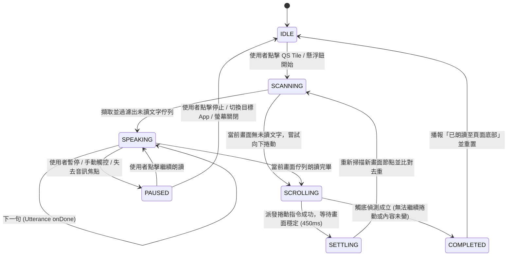

# 無障礙朗讀與自動捲動應用程式開發規格書 (Accessibility Auto-Reader, AAR)

## 1. 專案概述
本專案旨在開發一款基於 Android 無障礙服務（Accessibility Service）的現代化開源應用程式 **AAR (Accessibility Auto-Reader)**。主要功能為解析當前螢幕的可見文字，透過語音引擎（Text-to-Speech, TTS）進行即時朗讀，並在朗讀完畢後自動觸發向下捲動（節點捲動或模擬手勢滑動），搭配捲動後文字去重與觸底偵測機制，實現跨應用程式連續、無縫朗讀直至內容底部。

---

## 2. 系統架構與環境設定
* **最低支援版本：** Android 17 (API Level 37+) *(待確認：或支援 Android 8.0+ API 26+ / Android 14+ API 34+ 以相容現行市售 Pixel 8 Pro)*
* **目標測試平台：** Google Pixel 8 Pro
* **開發語言與架構：** Kotlin 2.2+、Coroutines + StateFlow (UDF 單向資料流)、Jetpack Compose
* **執行架構：** 採用 Android 原生 API 與官方標準實作，**100% 本地離線運作（無 `INTERNET` 網路權限）**
* **UI/UX 設計規範：** 嚴格遵循 Google Material Design 3 (M3) 設計準則（支援 Dynamic Color 動態色彩與深淺色主題）

---

## 3. 核心技術與服務元件架構

### 3.1 無障礙服務註冊 (Accessibility Service)
* **核心類別：** 繼承 `AccessibilityService`（`AutoReaderAccessibilityService`）。
* **權限宣告：** 於 `AndroidManifest.xml` 設定 `android.permission.BIND_ACCESSIBILITY_SERVICE`。
* **服務設定 (`res/xml/accessibility_service_config.xml`)：**
  * `accessibilityEventTypes`：設定為 `TYPE_WINDOW_CONTENT_CHANGED`、`TYPE_VIEW_SCROLLED` 與 `TYPE_WINDOW_STATE_CHANGED`。
  * `accessibilityFlags`：開啟 `flagRetrieveInteractiveWindows`、`flagReportViewIds` 及 `flagIncludeNotImportantViews`（視需求）。
  * `canRetrieveWindowContent`：設為 `true`。
  * `canPerformGestures`：設為 `true`（供自動捲動手勢派發使用）。
  * `notificationTimeout`：設為 `150` (ms)，抑制高頻 UI 變動事件風暴。
* **快捷控制 (Quick Settings Tile & Overlay HUD)：**
  * 實作 `TileService`（`AutoReaderTileService`），於系統下拉快捷欄提供「開始 / 停止朗讀」開關按鈕。
  * **無障礙懸浮控制膠囊 (`TYPE_ACCESSIBILITY_OVERLAY`)**：利用無障礙服務原生圖層權限（免額外申請 `SYSTEM_ALERT_WINDOW`），提供可收合的迷你懸浮控制列（播放/暫停、上一段/下一段、語速微調、停止）與當前朗讀段落視覺高亮框（Reading Focus Highlight）。

### 3.2 畫面內容解析 (Accessibility Node Info)
* 於服務觸發時呼叫 `getRootInActiveWindow()` 取得當前視窗根節點 `AccessibilityNodeInfo`。
* 透過深度優先搜尋（DFS）遍歷視圖樹狀結構，擷取可視文字（`getText()`、`getContentDescription()`）。
* **過濾與正規化規則：**
  * **可視性過濾**：排除 `isVisibleToUser == false`、寬高 `<= 0`、完全超出螢幕可視邊界（或遭頂部 AppBar / 底部 NavigationBar 遮擋）的節點，以及本應用自身的 `TYPE_ACCESSIBILITY_OVERLAY` 視窗。
  * **噪音與控制項過濾**：過濾純裝飾性按鈕、系統狀態列/導覽列、純符號/空白字串，以及常見無關互動標籤（如「複製」、「分享」、「返回」、「更多選項」、「讚」、「留言」等黑名單控制鈕與可自訂過濾詞庫）。
  * **空間拓樸排序**：依各節點於螢幕的絕對座標 `getBoundsInScreen(Rect)`（先依 Y 軸行高分群容差對齊，再由上至下 `top`、由左至右 `left`）重組自然閱讀順序。
  * **長文斷句切分**：針對超過單句長度或 `TextToSpeech.getMaxSpeechInputLength()` 上限的長段落，依中英文標點符號（`。！？；.!?; \n`）智慧切分為句子級別（Sentence-level）朗讀單元。

### 3.3 語音合成引擎 (Text-to-Speech)
* 實例化原生 `TextToSpeech` API。
* **套件檢查機制：** 初始化階段呼叫 `isLanguageAvailable()` 檢查目標語系套件。若回傳 `LANG_MISSING_DATA` 或 `LANG_NOT_SUPPORTED`，或未安裝離線語音包，主動引導使用者觸發 `TextToSpeech.Engine.ACTION_INSTALL_TTS_DATA` 或前往系統「文字轉語音輸出」設定頁。
* **狀態監聽：** 實作 `UtteranceProgressListener` 捕捉 `onStart(utteranceId)`、`onDone(utteranceId)`、`onStop(utteranceId, interrupted)` 與 `onError(utteranceId, errorCode)` 事件，驅動狀態機流轉與視覺高亮框同步移動。
* **音訊焦點與中斷管理 (`AudioFocus`)：**
  * 朗讀前請求 `AudioManager.AUDIOFOCUS_GAIN_TRANSIENT_MAY_DUCK`。
  * 監聽來電、鬧鐘、其他媒體播放搶佔焦點，以及藍牙/有線耳機拔除廣播（`AudioManager.ACTION_AUDIO_BECOMING_NOISY`），自動暫停朗讀。

### 3.4 使用者偏好與設定 (Settings - Jetpack DataStore)
* **語速控制：** 提供滑桿調整朗讀速度（呼叫 `TTS.setSpeechRate(float)`，支援 `0.5x ~ 2.0x`，步進 `0.1x`）與音調控制（`setPitch(float)`，預設 `1.0x`）。
* **語言切換：** 支援繁體中文（`Locale.TRADITIONAL_CHINESE` / `zh-TW`）、英文（`Locale.US` / `en-US`）及「智慧中英自動偵測」模式。
* **捲動與視覺偏好：**
  * 朗讀焦點高亮框開關（Highlight Box）。
  * 翻頁捲動模式（優先節點捲動 / 強制模擬手勢滑動）與滑動幅度設定（如螢幕高度之 65%）。
  * 段落間停頓延遲（`0ms ~ 500ms`）。

---

## 4. 自動化工作流程與邏輯控制

### 4.1 核心朗讀與捲動狀態機 (Finite State Machine)

### 4.2 自動向下捲動雙軌策略 (Dual Auto-Scroll Engine)
當目前畫面佇列全數收到 `onDone` 後，系統自動觸發向下翻頁：
1. **策略 A — 原生節點捲動 (Accessibility Action Scroll，優先採用)：**
   * 由畫面中心或文字密集區向上回溯尋找 `isScrollable == true` 且支援 `AccessibilityNodeInfo.AccessibilityAction.ACTION_SCROLL_FORWARD` 的容器節點（如 `RecyclerView`、`ScrollView`、`WebView`、Compose `LazyColumn`）。
   * 呼叫 `scrollableNode.performAction(AccessibilityNodeInfo.ACTION_SCROLL_FORWARD)`。此方式最穩定且絕不會誤觸畫面上的超連結或廣告。
2. **策略 B — 模擬手勢平滑捲動 (`dispatchGesture`，Fallback 或使用者指定)：**
   * 若目標 App 為自訂繪製容器而不支援標準 `ACTION_SCROLL_FORWARD`，則使用 `AccessibilityService.dispatchGesture()`。
   * 建立 `Path` 從螢幕中央偏下 `(width * 0.5f, height * 0.78f)` 垂直平滑移動至中央偏上 `(width * 0.5f, height * 0.22f)`，持續時間 `350ms`，模擬真人手指上滑翻頁。

### 4.3 捲動後穩定等待與文字去重演算法 (Settling & Deduplication)
* **畫面穩定等待期 (Scroll Settling Debounce)：**
  * 觸發捲動後，進入 `SETTLING` 狀態並等待慣性動畫結束（預設 `450ms`，或監聽最後一次 `TYPE_VIEW_SCROLLED` 事件後 debounce `250ms`），才執行下一輪 `getRootInActiveWindow()`。
* **滑動視窗指紋去重 (Sliding Window Fingerprint Deduplication)：**
  * 由於每次捲動通常僅移動約 60%~80% 螢幕高度，新畫面的上半部會與上一頁下半部的文字重疊。
  * 維護一個容量為最近 $K$ 個已讀段落（例如 $K = 50$）的正規化文字指紋集合（Normalized Text Hash Ring Buffer）與上一頁尾端錨點（Anchor Matching），自動剔除捲動後仍停留在畫面上的已讀段落，實現零重複、零漏讀的無縫接軌。

### 4.4 頁面觸底偵測 (Bottom-of-Page Detection)
滿足以下任一條件即判定為「已到達頁面底部」，自動結束朗讀循環並進入 `COMPLETED` 狀態：
1. 節點捲動 `ACTION_SCROLL_FORWARD` 回傳 `false`，且 Fallback 手勢滑動後畫面所有可視節點的文字內容與座標集合（Screen Content Signature）與捲動前 100% 相同。
2. 連續 **2 次** 觸發捲動後，擷取並去重後的「新増未讀文字數」皆為 `0`。

### 4.5 使用者手動干預與安全中斷機制 (Safety & Interruption Guards)
* **跨應用切換保護：** 鎖定開始朗讀時的目標套件名稱（`targetPackageName`）。若 `TYPE_WINDOW_STATE_CHANGED` 偵測到前景視窗切換至其他 App 或系統桌面（Launcher），自動暫停朗讀並停止派發手勢。
* **螢幕關閉保護：** 註冊 `BroadcastReceiver` 監聽 `Intent.ACTION_SCREEN_OFF`，螢幕鎖定時立即停止自動捲動與朗讀（或依設定改為僅讀完當前頁）。
* **下拉通知欄 / 控制中心保護：** 當偵測到 `com.android.systemui` 視窗覆蓋（如使用者下拉 Quick Settings 準備關閉磁貼）時，立即凍結掃描與捲動，避免誤讀通知欄訊息。

---

## 5. 隱私安全與 Google Play 合規設計 (Privacy & Compliance)
* **100% 離線零網路權限：** `AndroidManifest.xml` **完全不宣告** `android.permission.INTERNET`。所有螢幕文字擷取僅存於記憶體佇列供本地系統 TTS 合成語音，絕不寫入磁碟日誌、絕不外傳。
* **無障礙權限醒目揭露 (Prominent Disclosure)：** 於首次引導開啟無障礙服務前，透過 Material 3 對話框明確向使用者說明為何需要 `AccessibilityService`（擷取螢幕文字與自動翻頁）及零資料收集承諾，完全符合 Google Play 無障礙 API 政策。
* **防敏感畫面誤讀保護：** 當偵測到目前視窗為密碼輸入框（`isPassword == true`）時自動跳過該節點。
